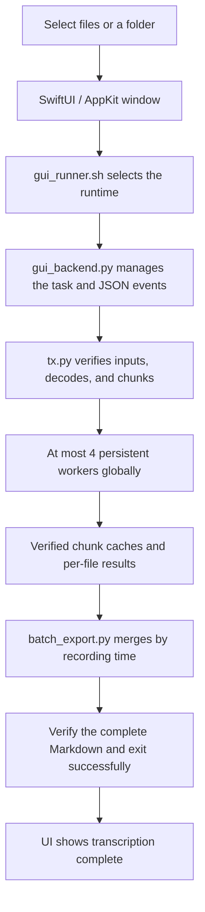

# Development and architecture

[中文](ARCHITECTURE.md) | **English** · [Back to README](../README.en.md)

The project combines a native macOS interface with a local Python transcription pipeline. The GUI follows “select recordings → transcribe → take one Markdown file.” Models, scheduling, recovery, and packaging live in `程序文件/`.

## Data flow



Transcription does not send audio to a cloud service. The full DMG carries models and a runtime; preparing a development environment from source requires downloading dependencies and models.

## Module responsibilities

| File | Responsibility |
|---|---|
| `TranscriberApp.swift` | Compact window, file selection, icon buttons, per-file state, queue display, transcript actions |
| `gui_runner.sh` | Choose the bundled offline runtime or development environment and set working directories |
| `gui_backend.py` | Collect inputs, enforce one GUI task, launch processes, forward explicit progress events, stop and verify completion |
| `tx.py` | Input snapshots, decoding, chunking, global worker pool, cache recovery, per-file artifacts |
| `light_engine.py` | Paraformer ONNX inference, CIF alignment, VAD and speaker-feature interfaces |
| `light_postprocess.py` | Bounded punctuation/VAD processing, speaker clustering, unknown speakers, review items |
| `batch_export.py` | Parse recording times, verify sources and artifacts, write merged Markdown and batch indices |
| `models-light.manifest.json` / `models.tsv` | Model files, sources, and integrity records |
| `requirements-*.txt` | Pinned dependency versions and hashes |
| `build_app.sh` | Compile and ad-hoc sign the native app |
| `package_release.py` / `build_release.sh` | Assemble a portable runtime, audit binaries, collect source and licenses, create the DMG |

## Models and concurrency

The light pipeline combines FSMN VAD, Paraformer ONNX INT8, CT-Transformer punctuation, and CAM++ speaker features. Recognition currently uses ONNX Runtime's `CPUExecutionProvider`; it does not use Metal GPU inference. Workers reuse loaded models and thread settings rather than rebuilding the environment for every chunk.

The default processing chunk is approximately 15 minutes. At most four workers run globally, further limited by task count and thread configuration. This is not four new workers per file. During batch processing, a queued recording enters as a completed one leaves its slot. A single long recording can also benefit from parallel chunks.

Concurrency changes execution order only. Each file is reconstructed by original chunk index. Batch Markdown is ordered by filename date/time; unknown times follow known ones, and equal times keep a stable order.

## Progress and completion

The backend sends newline-delimited JSON events to the interface:

| Event | Meaning |
|---|---|
| `file` | Source path, state, and completed-chunk fraction for one file |
| `status` | Overall progress and processing stage |
| `complete` | Verified merged-document path for this batch |
| `error` / `cancelled` | Failure or cancellation |

Per-file progress comes from completed chunks, not an estimated timer. Short recordings may therefore jump directly from processing to complete. Overall progress stays below 100% until the document is verified. A `complete` event alone is insufficient: the backend must exit successfully and the output must still exist and be valid.

While processing, active rows come first, queued rows next, and completed rows move down with a gray state. A successful batch restores the original list order. This **display order** is separate from the Markdown's **recording-time order**.

## Data, recovery, and provenance

```text
~/录音转写/
├── 转写结果/
│   ├── 合并全文.md       Latest complete transcript
│   ├── 合并全文/         Historical batch transcripts
│   └── 轻量试用/         Per-file results and recovery caches
└── 日志/                Runtime and error logs
```

Each batch retains its own result pointer so the app does not open another task's document when the “latest” file changes. Cache and export writes are atomic. Input, configuration, model, and output hashes help determine validity. Verified chunks can be recovered; missing, corrupt, or incompatible artifacts cannot count as completed work.

Sources are checked before and after reading. Filesystem metadata changes with unchanged content require a content-hash check; changed audio invalidates the old result. Cancellation cleans up process groups and confirms that workers have stopped.

Merged Markdown retains local source links, timestamps relative to each recording, and per-recording speaker numbers. It does not establish speaker identity across files. Text without a reliable alignment becomes a review item; a language model does not fill in missing speech. Additional CLI options do not imply corresponding GUI controls.

## Local development

Use an Apple Silicon Mac with macOS 14+, Xcode Command Line Tools, and network access for the initial setup.

```bash
git clone https://github.com/limadaiana810-oss/audio-to-markdown-mac.git
cd audio-to-markdown-mac

# Prepare the light development environment and models; download and verify on first run
bash 程序文件/install.sh --engine light

# Compile the development app into the repository root
bash 程序文件/build_app.sh

# Run tests with the installed development environment
"$HOME/Library/Application Support/录音转写工具/venv-light/bin/python" \
  -m unittest discover -s 程序文件/tests -v

# Create the offline DMG with runtime, models, source, documentation, and licenses
bash 程序文件/build_release.sh
```

The development environment defaults to `~/Library/Application Support/录音转写工具/`. A full build involves more than compiling Swift: model export and runtime setup require additional downloads and disk space. The development app differs from the complete offline DMG; end users should prefer a Release download.

Full distribution builds require prepared `python`, `venv-light`, and `models-light` directories. Set `TX_BUILD_APP_DIR` to their parent directory to use a different build source. Packaging caches live in `.package-cache/`; output defaults to `发布/`.

The original FFmpeg source archive is excluded from Git history. Builds use `fetch_ffmpeg_source.py` to retrieve it from the official source and verify a pinned SHA-256. The matching original source, build script, and license materials are included with the distribution. `build_audio_runtime.sh` builds FFmpeg; other distribution materials are in `分发资源/`.

## Validation and changes

`tests/` covers scheduling, corrupt caches, result integrity, ordering, changed inputs, cancellation, and native UI state. Tests construct temporary samples and do not need contributors' private meeting recordings. Passing unit tests does not establish real-audio accuracy, offline operation of the final DMG, or compatibility on a different Mac.

Release checks should also cover the app version, signature integrity, runtime relocation, valid output, installer SHA-256, and matching source and licenses. Current signing is ad-hoc; signature integrity is not Apple notarization. See the [release guide](RELEASING.en.md) for the complete process.

Change the module that owns the behavior: Swift for presentation, `batch_export.py` for document formatting, `tx.py` for scheduling and recovery, and the light engine for recognition and speaker quality. Model or inference-parameter changes should also address cache fingerprints and measurement baselines.
