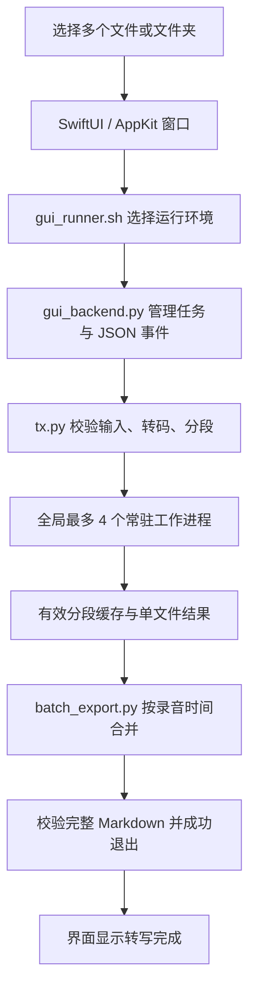

# 开发与架构

**中文** | [English](ARCHITECTURE.en.md) · [返回首页](../README.md)

本项目由原生 macOS 界面和本地 Python 转写链路组成。GUI 面向“选录音 → 转写 → 取走一份 Markdown”；模型、调度、恢复和打包实现集中在 `程序文件/`。

## 数据怎么流动



转写时不把音频发送到云端。完整 DMG 携带运行环境和模型；从源码准备开发环境时，需要下载依赖与模型。

## 模块职责

| 文件 | 职责 |
|---|---|
| `TranscriberApp.swift` | 小窗口、文件选择、图标按钮、逐文件状态、队列展示与文稿操作 |
| `gui_runner.sh` | 选择内置离线运行环境或开发环境，设置运行目录 |
| `gui_backend.py` | 收集输入、任务互斥、启动子进程、转换明确的进度协议、停止与完成校验 |
| `tx.py` | 输入快照、转码、分段、全局进程池、缓存恢复及单文件产物 |
| `light_engine.py` | Paraformer ONNX 推理、CIF 时间对齐、VAD 与说话人特征接口 |
| `light_postprocess.py` | 有界标点/VAD处理、说话人聚类、未知说话人与待确认内容 |
| `batch_export.py` | 录音时间解析、来源与产物校验、合并 Markdown 与批次索引 |
| `models-light.manifest.json` / `models.tsv` | 模型文件、来源与完整性记录 |
| `requirements-*.txt` | 依赖固定版本与哈希 |
| `build_app.sh` | 编译原生应用与本地签名 |
| `package_release.py` / `build_release.sh` | 整理便携运行环境、检查二进制、收集源码与许可、生成 DMG |

## 模型与并发

轻量链路组合 FSMN VAD、Paraformer ONNX INT8、CT-Transformer 标点和 CAM++ 说话人特征。识别主链路目前使用 ONNX Runtime 的 `CPUExecutionProvider`，不依赖 Metal GPU 推理。模型与线程在工作进程中复用，避免每段音频重复创建环境。

默认处理段约 15 分钟。全局最多四个工作进程处理任务；并发上限受任务数量和可用线程配置限制，并非每份录音再单独开四个进程。多文件处理中，完成的文件腾出位置后，排队文件自动补位。单份长音频也能利用分段并行。

并发只改变计算先后。单文件按原始分段序号还原；批量文稿按文件名中的日期时间排序，未知时间排在已知时间之后，相同时间保留稳定顺序。

## 进度与完成判定

后台向界面发送逐行 JSON 事件：

| 事件 | 含义 |
|---|---|
| `file` | 单文件路径、状态、已完成分段比例 |
| `status` | 总进度和处理阶段 |
| `complete` | 经验证的本次合并文稿路径 |
| `error` / `cancelled` | 失败或取消结果 |

单文件比例来自实际完成的分段，不用计时器猜测进度；因此短录音可能从处理中直接完成。整体进度在文稿验证完成前不显示 100%。`complete` 事件本身也不足以让界面成功：后台必须正常退出，输出必须仍存在且有效。

处理中，活跃文件靠前，排队文件居中，完成文件靠后并显示灰色状态。整批成功后，窗口恢复原始列表顺序。这个**展示顺序**与 Markdown 的**录音时间排序**是两个独立规则。

## 数据、恢复与来源

```text
~/录音转写/
├── 转写结果/
│   ├── 合并全文.md       最近一次完整文稿
│   ├── 合并全文/         各批次历史全文
│   └── 轻量试用/         单文件结果与恢复缓存
└── 日志/                运行与错误记录
```

每批保留独立结果指针，避免多个任务更新“最近一次”时打开错稿。缓存与导出使用原子写入，输入、参数、模型及输出哈希参与有效性判断。已完成的健康分段可以恢复，缺失、损坏或不兼容的结果不能冒充完成。

源文件在读取前后校验。仅文件系统元数据变化而内容未变的情况需要内容哈希确认；源音频内容变化会使原结果失效。取消时清理进程组，并确认后台工作进程已结束。

合并文稿保留来源文件的本地链接、每份录音的相对时间戳和说话人编号。跨文件不会自动认定同一身份；无法可靠定位的文字进入待确认项，不用语言模型补写缺失语音。CLI 中的额外参数不代表 GUI 已提供相应入口。

## 本地开发

需要 Apple Silicon Mac、macOS 14+、Xcode Command Line Tools，以及首次准备依赖时的网络连接。

```bash
git clone https://github.com/limadaiana810-oss/audio-to-markdown-mac.git
cd audio-to-markdown-mac

# 准备开发用轻量环境与模型；首次执行会下载并校验依赖
bash 程序文件/install.sh --engine light

# 编译开发应用，输出到仓库根目录
bash 程序文件/build_app.sh

# 使用已安装的开发环境执行测试
"$HOME/Library/Application Support/录音转写工具/venv-light/bin/python" \
  -m unittest discover -s 程序文件/tests -v

# 制作含运行环境、模型、源码、说明和许可材料的离线 DMG
bash 程序文件/build_release.sh
```

开发环境默认位于 `~/Library/Application Support/录音转写工具/`。源码构建不是“只编译一个 Swift 文件”：模型导出与运行环境准备需要额外下载及磁盘空间。开发应用与完整离线 DMG 用途不同，普通使用者优先下载 Release。

完整分发构建需要准备好的 `python`、`venv-light` 和 `models-light`。可用 `TX_BUILD_APP_DIR` 指定它们所在的来源目录。打包缓存位于 `.package-cache/`，成品默认位于 `发布/`。

FFmpeg 原始源码归档不放进 Git 历史；构建使用 `fetch_ffmpeg_source.py` 从官方地址获取并校验固定 SHA-256。对应原始源码、构建脚本和许可材料会包含在分发包中。FFmpeg 构建入口为 `build_audio_runtime.sh`，其他分发材料位于 `分发资源/`。

## 验证与修改边界

`tests/` 覆盖调度、坏缓存、结果校验、时间顺序、输入变化、取消和原生界面状态等行为。测试会构造临时样本，不需要贡献者的私人会议录音。单元测试通过不能替代真实音频准确率测试、最终 DMG 的离线启动检查或不同 Mac 的兼容性验证。

涉及发布时还应核对：应用版本、签名完整性、运行环境可迁移、文稿输出有效、安装包 SHA-256、附带源码和许可一致。当前签名为本地签名，不能把完整性校验写成 Apple 公证。发布的完整步骤见[发布流程](RELEASING.md)。

建议按职责修改：界面样式看 Swift 文件，输出格式看 `batch_export.py`，调度与恢复看 `tx.py`，识别和说话人质量看轻量引擎。模型或识别参数变化时同步考虑缓存指纹与测量基线。
